# CDE Pearls Lombok — Dokumentasi Rancangan Sistem Lengkap
**Versi:** 1.0.0 | **Tanggal:** 12 September 2026 | **Author:** Tim CDE Pearls Dev

---

## Daftar Isi

1. [Arsitektur Sistem](#1-arsitektur-sistem)
2. [Flowchart — Alur Pengguna (Customer Journey)](#2-flowchart--alur-pengguna-customer-journey)
3. [Flowchart — Alur Pembelian via WhatsApp](#3-flowchart--alur-pembelian-via-whatsapp)
4. [Flowchart — Alur Kustomisasi 3D (Atelier)](#4-flowchart--alur-kustomisasi-3d-atelier)
5. [Flowchart — Alur Admin (Super Admin Panel)](#5-flowchart--alur-admin-super-admin-panel)
6. [Use Case Diagram](#6-use-case-diagram)
7. [Class Diagram (Struktur Data)](#7-class-diagram-struktur-data)
8. [Sequence Diagram — Proses Checkout WhatsApp](#8-sequence-diagram--proses-checkout-whatsapp)
9. [Sequence Diagram — Admin Tambah Produk](#9-sequence-diagram--admin-tambah-produk)
10. [Sequence Diagram — 3D Customizer](#10-sequence-diagram--3d-customizer)
11. [Entity Relationship Diagram (ERD)](#11-entity-relationship-diagram-erd)
12. [State Diagram — Status Pesanan](#12-state-diagram--status-pesanan)
13. [Component Diagram — Arsitektur Frontend](#13-component-diagram--arsitektur-frontend)
14. [Activity Diagram — Filter Kategori Produk](#14-activity-diagram--filter-kategori-produk)
15. [Data Flow Diagram (DFD)](#15-data-flow-diagram-dfd)
16. [Deployment Diagram](#16-deployment-diagram)

---

## 1. Arsitektur Sistem

```
CUSTOMER LAYER (frontend/)               ADMIN LAYER TERPISAH (admin/)
├── index.html (5 Kategori & Filter)    ├── index.html (Pusat Kontrol Super Admin)
├── customizer.html (Atelier 3D PBR)    ├── css/admin.css
├── cart.html (Invoice WA & Pelacak)    └── js/admin.js (RBAC & Controller)
├── customer.html (Dashboard Pembeli)        ├── Dashboard & KPI Omset
├── about.html (Edukasi Budidaya)            ├── Katalog Produk & 5 Kategori
├── contact.html (Concierge Senggigi)        ├── Stok Butir Mutiara (+/-)
├── faq.html (Tanya Jawab Interaktif)        ├── Pesanan & Verifikasi Lunas (PAID)
└── blog.html (Jurnal Gemologi Mutiara)      ├── WhatsApp Leads CRM
                                             ├── Daftar Pelanggan & Ulasan
                                             ├── Admin Users (Super Admin Only)
                                             ├── Laporan & Audit Logs (Super Admin Only)
                                             └── Pengaturan Gateway WhatsApp

                    SHARED STATE LAYER (store.js & whatsappService.js)
        CDEStore -- Central State, RBAC, Leads CRM, Audit Logs & LocalStorage
        Products (5 Kategori) | Orders (Dual-Status) | Users | Leads | Settings

                    BROWSER PERSISTENCE (localStorage)
   cde_pearls_products_v3 | cde_pearls_categories_v1 | cde_pearls_cart_v2
   cde_pearls_orders_v2   | cde_pearls_users_v1      | cde_pearls_leads_v1
   cde_pearls_settings_v2 | cde_pearls_audit_logs_v1 | cde_pearls_reviews_v1
```

**Teknologi Stack:**
- **Frontend & Styling:** HTML5 Semantik, Vanilla CSS3 (Deep Navy `#0B1F33`, Pearl White `#F8F7F2`, Champagne Gold `#C9A96E`)
- **Typography:** Inter (UI & Data) + Playfair Display (Luxury Headings)
- **Icons:** Lucide Icons (stroke: 1.8–2px, rounded, tanpa emoji)
- **Logic & Store:** Vanilla JavaScript ES6+ (Event-driven Store Architecture)
- **3D Engine:** Three.js + OrbitControls PBR Material Simulation
- **Purchase Gateway:** WhatsApp API (wa.me deeplink dengan generator pesan terstruktur)
- **RBAC Security:** Role-Based Access Control (`CUSTOMER`, `ADMIN`, `SUPER_ADMIN`) dengan Admin Cloaking terisolasi penuh
- **Hosting:** Static Web Architecture (Zero Server Maintenance, Instant Performance)

---

## 2. Flowchart — Alur Pengguna (Customer Journey)

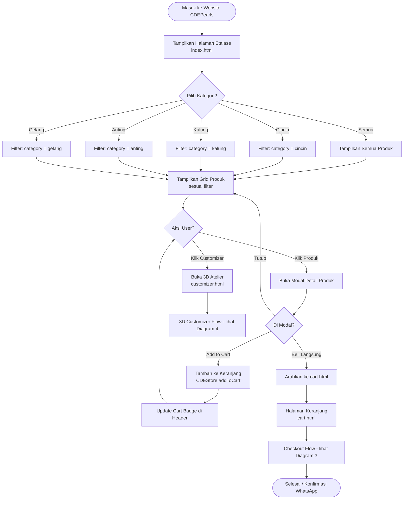

---

## 3. Flowchart — Alur Pembelian via WhatsApp

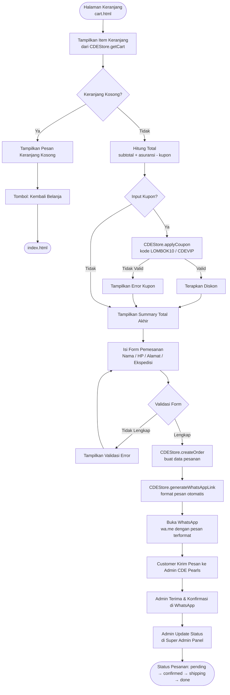

---

## 4. Flowchart — Alur Kustomisasi 3D (Atelier)

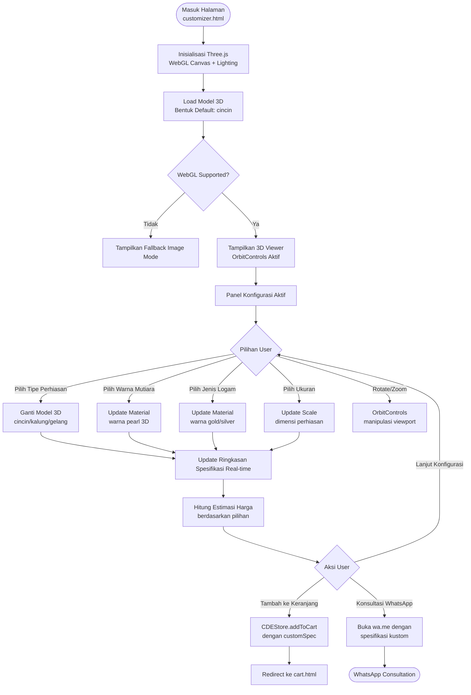

---

## 5. Flowchart — Alur Admin (Super Admin Panel)

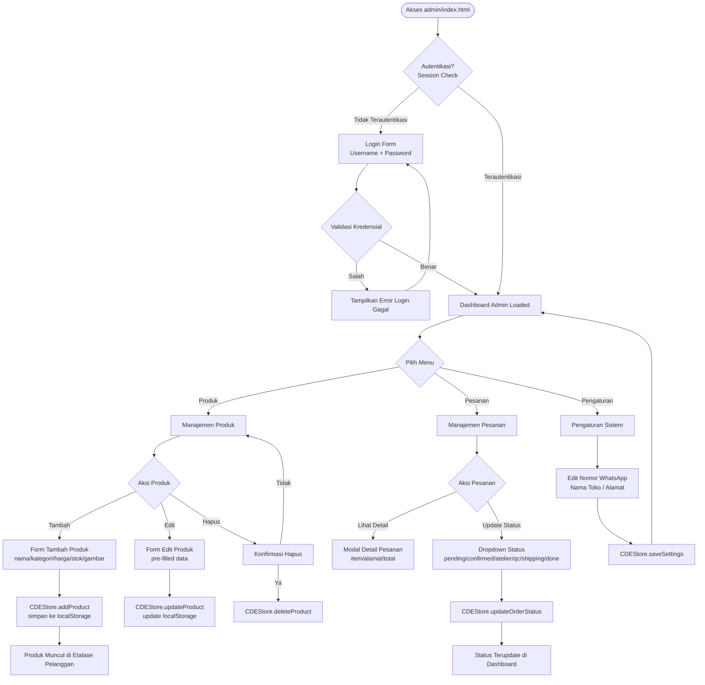

---

## 6. Use Case Diagram

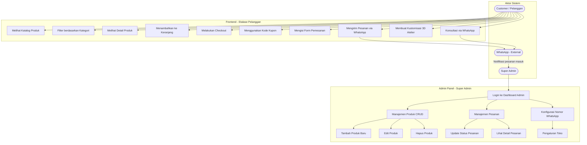

---

## 7. Class Diagram (Struktur Data)

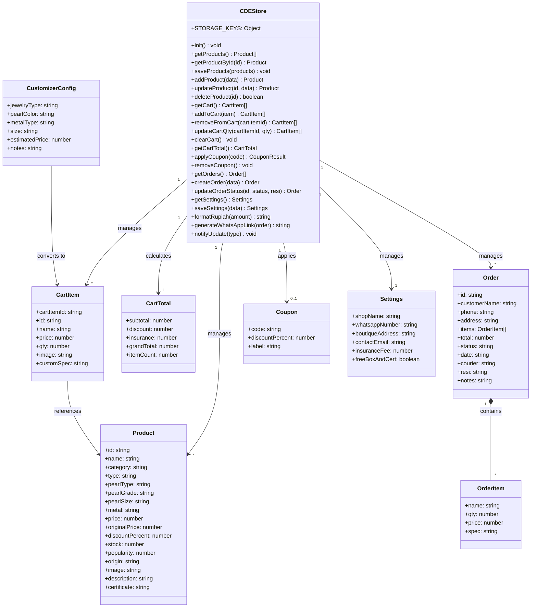

---

## 8. Sequence Diagram — Proses Checkout WhatsApp

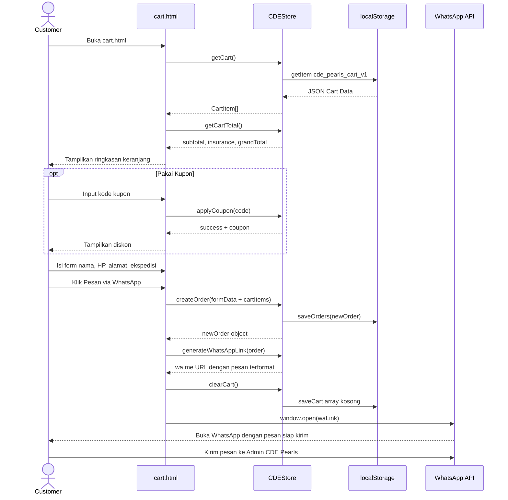

---

## 9. Sequence Diagram — Admin Tambah Produk

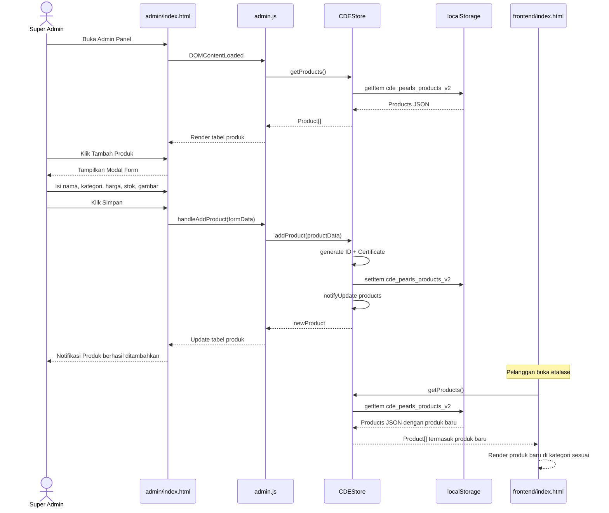

---

## 10. Sequence Diagram — 3D Customizer

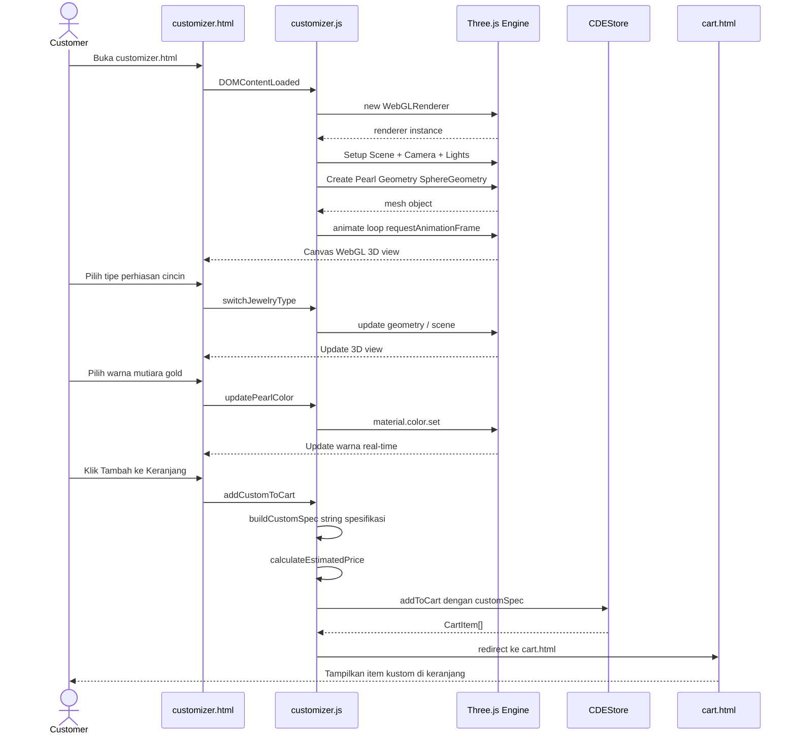

---

## 11. Entity Relationship Diagram (ERD)

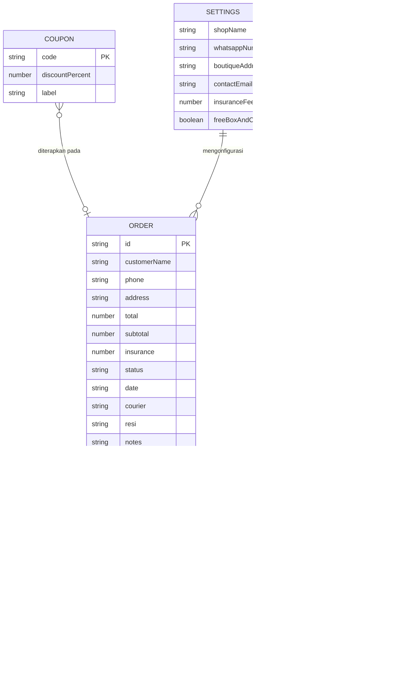

---

## 12. State Diagram — Alur Status Ganda (Payment & Order Lifecycle)

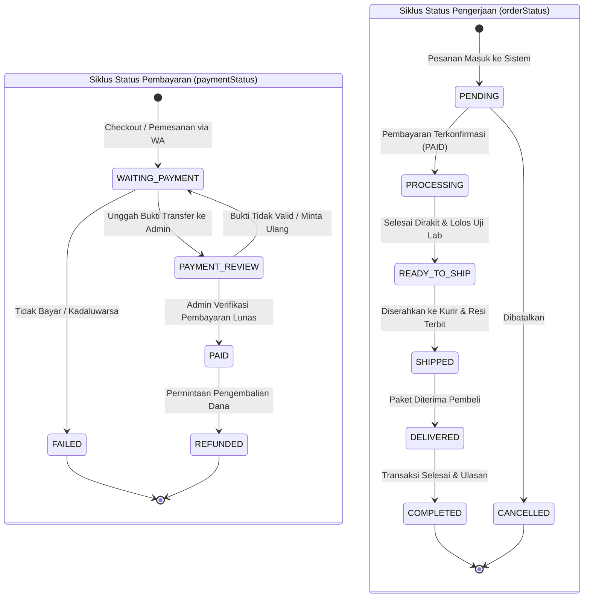

---

## 13. Component Diagram — Arsitektur Frontend

```mermaid
graph TB
    subgraph BROWSER["Browser - Client Side"]

        subgraph FRONTEND["frontend/ - Customer Layer"]
            IH["index.html\nEtalase + Filter + Modal"]
            CH["customizer.html\n3D Atelier"]
            CRT["cart.html\nCheckout"]

            subgraph CSS_FE["css/"]
                SCSS["style.css\nGlobal + Luxury Buttons"]
                CCSS["customizer.css\n3D Panel"]
                CARTCSS["cart.css\nCheckout Form"]
            end

            subgraph JS_FE["js/"]
                STORE["store.js\nCentral State Manager"]
                MAIN["main.js\nProduct Render + Filter"]
                CUSTJS["customizer.js\nThree.js Controller"]
                CARTJS["cart.js\nCart Logic"]
                THREE["vendor/three.min.js\n3D Engine"]
                ORBIT["vendor/OrbitControls.js\n3D Controls"]
            end
        end

        subgraph ADMIN["admin/ - Super Admin Layer"]
            AIH["index.html\nAdmin Dashboard"]
            subgraph CSS_ADM["css/"]
                ADMCSS["admin.css"]
            end
            subgraph JS_ADM["js/"]
                ADMJS["admin.js\nCRUD Produk dan Pesanan"]
            end
        end

        subgraph STORAGE["localStorage - Persistence Layer"]
            P["cde_pearls_products_v2"]
            C["cde_pearls_cart_v1"]
            O["cde_pearls_orders_v1"]
            S["cde_pearls_settings_v1"]
            CPN["cde_pearls_coupon_v1"]
        end
    end

    subgraph EXTERNAL["External Services"]
        WA_API["WhatsApp API\nwa.me deeplink"]
        UNSPLASH["Unsplash CDN\nProduct Images"]
        GFONTS["Google Fonts CDN"]
    end

    IH --> STORE & MAIN & SCSS
    CH --> STORE & CUSTJS & CCSS & THREE & ORBIT
    CRT --> STORE & CARTJS & CARTCSS
    AIH --> STORE & ADMJS & ADMCSS

    STORE <-->|read/write| P & C & O & S & CPN
    ADMJS --> STORE

    CARTJS -->|wa.me deeplink| WA_API
    CUSTJS -->|consultation link| WA_API
    IH -->|image src| UNSPLASH
    IH & CH & CRT & AIH -->|fonts| GFONTS
```

---

## 14. Activity Diagram — Filter Kategori Produk

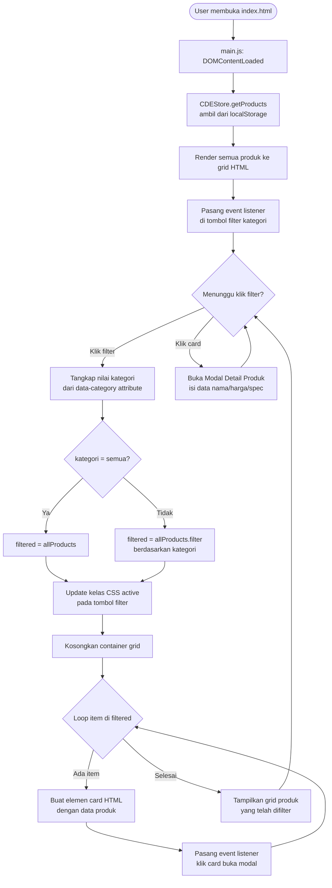

---

## 15. Data Flow Diagram (DFD)

### Level 0 — Context Diagram

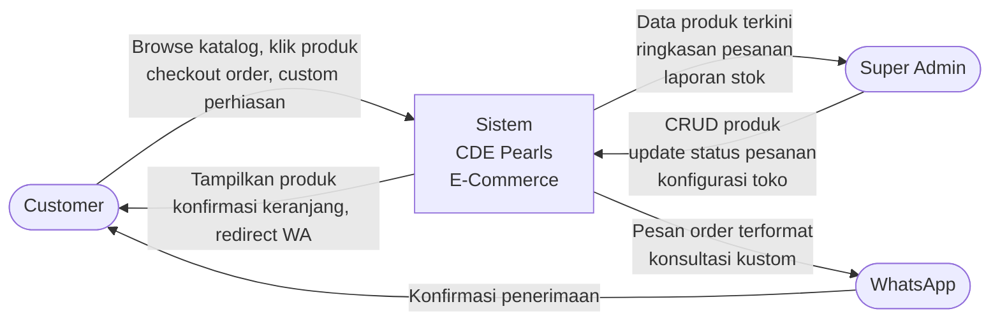

### Level 1 — Sub-sistem Detail

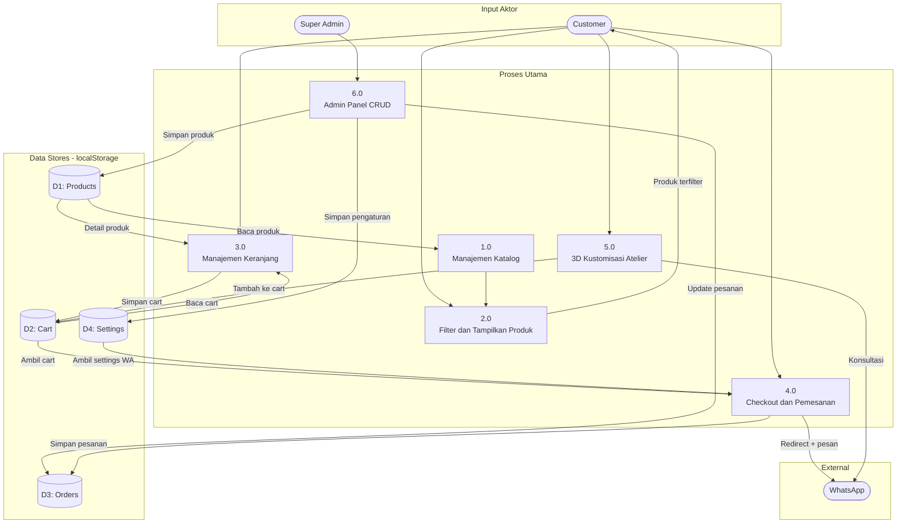

---

## 16. Deployment Diagram

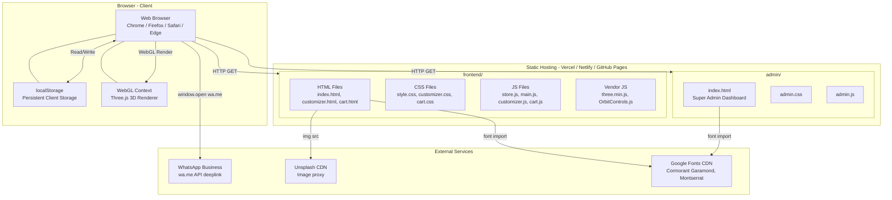

> **Catatan:** Tidak ada server-side backend. Semua data disimpan di localStorage browser. Cocok untuk MVP dan demo profesional. Siap deploy ke Vercel / Netlify / GitHub Pages.

---

## Ringkasan Arsitektur

| Aspek | Detail |
|---|---|
| **Arsitektur** | Client-side SPA Static Site |
| **State Management** | CDEStore singleton + localStorage |
| **Halaman Customer** | index.html, customizer.html, cart.html |
| **Halaman Admin** | admin/index.html (terpisah penuh) |
| **3D Engine** | Three.js r128 + OrbitControls |
| **Purchase Flow** | WhatsApp Deeplink wa.me |
| **Kategori Produk** | Cincin, Kalung, Anting, Gelang |
| **Status Pesanan** | pending → confirmed → atelier → qc → shipping → done |
| **Kupon Diskon** | LOMBOK10 (10%), CDEVIP (15%) |
| **Persistence** | 5 key localStorage |
| **Notifikasi** | Custom DOM Event: cde_store_updated |
| **Backend** | Tidak ada (100% client-side) |
| **Database** | Tidak ada (localStorage sebagai pengganti) |

---

*Dokumen ini dibuat berdasarkan analisis kode sumber CDE Pearls E-Commerce System.*  
*© 2026 CDE Pearls Lombok — Confidential System Design Document*
