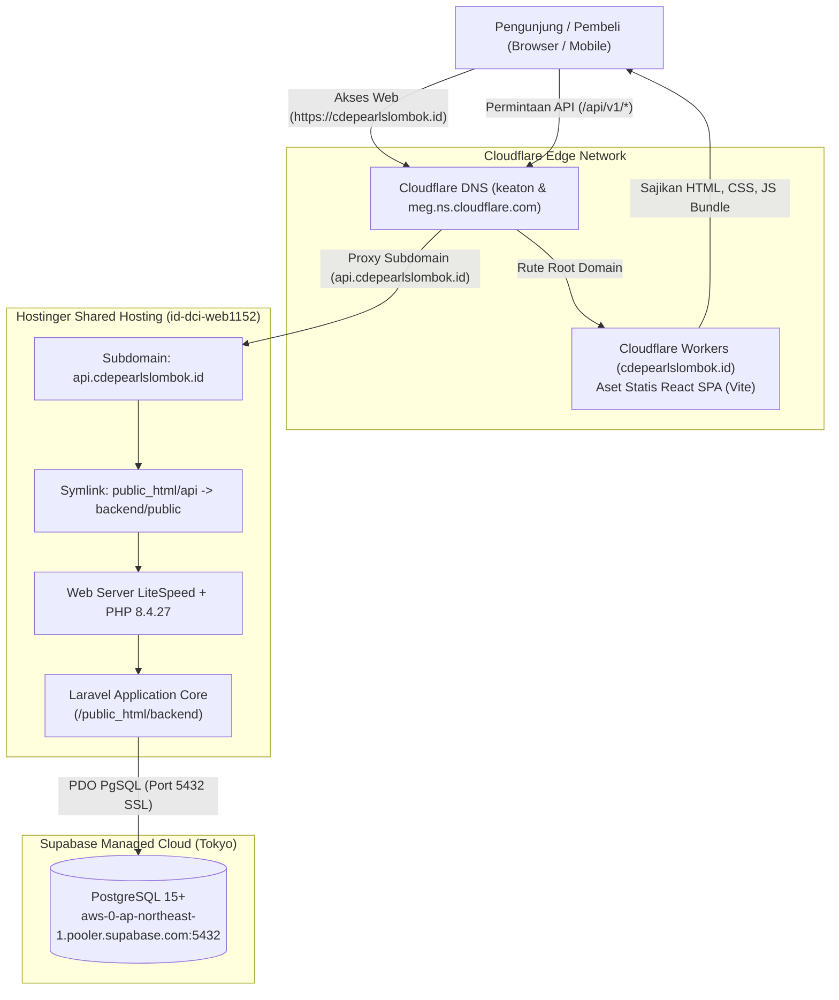

# LAPORAN TEKNIS DEPLOYMENT ARSITEKTUR HYBRID CLOUD
## CD'E Pearls Lombok (Haute Joaillerie Samudera Indonesia)

* **Tanggal Laporan**: 04 November 2026
* **Domain Utama (Frontend)**: `https://cdepearlslombok.id`
* **Subdomain API (Backend)**: `https://api.cdepearlslombok.id`
* **Infrastruktur**: 
  - **Frontend**: Cloudflare Workers (Static Assets CDN)
  - **Backend**: Hostinger Shared Hosting (PHP 8.4.27 + LiteSpeed)
  - **Database**: Supabase PostgreSQL (Managed Cloud, AWS ap-northeast-1 Tokyo)
  - **DNS & Keamanan Edge**: Cloudflare Managed DNS + SSL Full Enkripsi

---

## 1. Ringkasan Eksekutif

Proses implementasi dan peluncuran backend Laravel ke Hostinger serta penyambungan frontend ke Cloudflare telah berhasil dilakukan secara menyeluruh dengan arsitektur **Decoupled / Hybrid Cloud**.

Sistem saat ini telah beroperasi secara aktif di internet:
1. **Frontend React SPA** berjalan di jaringan Cloudflare Edge (`cdepearlslombok.id`) dengan kecepatan respon tinggi dan proteksi DDoS global.
2. **Backend API Laravel** berjalan di Hostinger (`api.cdepearlslombok.id`) dengan runtime PHP 8.4 modern, melayani routing API v1 dan pemrosesan data.
3. **Database Relasional** dikelola oleh Supabase PostgreSQL via SSL connection pooling.
4. **Keamanan**: Akses langsung ke file sensitif (`.env`, konfigurasi, dan repositori `.git`) diproteksi penuh dengan respon `403 Forbidden`.

---

## 2. Diagram Topologi Sistem



---

## 3. Kronologi Lengkap & Solusi Teknis (Step-by-Step)

### Tahap 1: Analisis Lingkungan Hostinger & Akses SSH
* **Akses**: Dilakukan via PuTTY SSH ke akun `u904958806@id-dci-web1152` di direktori:
  `/home/u904958806/domains/cdepearlslombok.id/public_html`.
* **Kondisi Awal**: Repositori git telah ter-clone di server dengan commit `31bbfde`.
* **Identifikasi Awal**: Percobaan `git pull` sempat ditolak oleh GitHub karena autentikasi sandi biasa tidak lagi didukung (GitHub mewajibkan Personal Access Token). Namun diverifikasi bahwa commit repositori di server sudah berada di commit paling mutakhir (`31bbfde`).

---

### Tahap 2: Pengelolaan Versi PHP & Resolusi Dependensi Composer
* **Kendala yang Ditemukan**:
  Saat mengeksekusi `composer install --no-dev --optimize-autoloader`, muncul penolakan platform:
  ```text
  Problem 1: openspout/openspout v5.13.0 requires php ~8.4.0 || ~8.5.0
  Problem 2-17: symfony/* v8.1.x requires php >=8.4.1
  Current version: PHP 8.3.36
  ```
* **Akar Masalah**:
  Pengembangan lokal menggunakan PHP 8.5, sehingga berkas `composer.lock` mengunci dependensi modern yang membutuhkan PHP >= 8.4. Server Hostinger secara default masih menjalankan PHP 8.3.
* **Solusi & Eksekusi**:
  1. Melalui hPanel Hostinger, versi PHP domain dinaikkan ke **PHP 8.4**.
  2. Ditemukan binary sistem CloudLinux di server: `/opt/alt/php84/usr/bin/php`.
  3. Dibuat alias persisten di lingkungan terminal PuTTY:
     ```bash
     alias php='/opt/alt/php84/usr/bin/php'
     echo "alias php='/opt/alt/php84/usr/bin/php'" >> ~/.bashrc
     ```
  4. Dependensi berhasil dipasang penuh menggunakan:
     ```bash
     /opt/alt/php84/usr/bin/php $(which composer) install --no-dev --optimize-autoloader
     ```

---

### Tahap 3: Konfigurasi Database Supabase & Ekstensi PostgreSQL
* **Konfigurasi Lingkungan (`.env`)**:
  Dibuat berkas `.env` di dalam direktori `backend/` yang mengarah ke pooler Supabase:
  ```env
  APP_NAME="CDE Pearls"
  APP_ENV=production
  APP_KEY=base64:vXqVj294/97yHN+FVs2C0WlXjIu0AZWAVzXXDkATZ1E=
  APP_DEBUG=false
  APP_URL=https://api.cdepearlslombok.id

  DB_CONNECTION=pgsql
  DB_HOST=aws-0-ap-northeast-1.pooler.supabase.com
  DB_PORT=5432
  DB_DATABASE=postgres
  DB_USERNAME=postgres.ecajfnwluvmqevitsmmu
  DB_PASSWORD=[KREDENSIAL_SUPABASE_TERLINDUNGI]

  SESSION_DRIVER=database
  CACHE_STORE=database
  QUEUE_CONNECTION=sync
  ```
* **Kendala Driver PostgreSQL**:
  Perintah `php artisan migrate --force` awalnya gagal dengan pesan: `could not find driver (Connection: pgsql)`.
* **Akar Masalah**:
  Hostinger secara bawaan hanya mengaktifkan driver MySQL pada modul PHP default. Modul PostgreSQL (`pdo_pgsql.so` dan `pgsql.so`) belum aktif di konfigurasi web server.
* **Solusi**:
  1. Mengaktifkan ekstensi `pdo_pgsql` dan `pgsql` melalui hPanel (**PHP Configuration > PHP Extensions**).
  2. Menempatkan konfigurasi `php.ini` tambahan di folder publik backend:
     ```ini
     extension=pdo_pgsql.so
     extension=pgsql.so
     ```
  3. Menambahkan variabel wajib keamanan seeder akun produksi:
     ```env
     SEED_USER_PASSWORD=UserAman2026!
     SEED_ADMIN_PASSWORD=AdminAman2026!
     SEED_SPI_PASSWORD=SpiAman2026!
     ```
  4. Membersihkan cache konfigurasi lama (`rm -f bootstrap/cache/config.php`).
* **Hasil**:
  Seluruh migrasi skema tabel (users, cache, jobs, personal_access_tokens, cde_pearls_schema, vouchers, tracking_tokens, stock_columns) dan data awal seeder berhasil mendarat rapi di database Supabase.

---

### Tahap 4: Arsitektur Subdomain & Isolasi Routing API
* **Keputusan Arsitektur**:
  Untuk performa optimal, Frontend dipisahkan ke edge CDN Cloudflare pada domain utama (`cdepearlslombok.id`), sedangkan Backend dilayani khusus oleh subdomain Hostinger (`api.cdepearlslombok.id`).
* **Langkah Implementasi**:
  1. Pembuatan subdomain `api` di hPanel Hostinger.
  2. Penghubungan jalur folder DocumentRoot subdomain via symlink Linux:
     ```bash
     cd /home/u904958806/domains/cdepearlslombok.id/public_html
     rm -rf api
     ln -s backend/public api
     ```
  3. Penyetelan proteksi file sensitif di root `public_html/.htaccess` agar berkas `.env` dan kode mentah tertolak dengan status `403 Forbidden`.
  4. Pembaruan dan penguncian cache Laravel:
     ```bash
     php artisan config:cache
     php artisan route:cache
     ```

---

### Tahap 5: Manajemen DNS Cloudflare & Resolusi Konflik Record
* **Peralihan Nameserver**:
  Nameserver domain `cdepearlslombok.id` diubah di panel registrar Hostinger menjadi nameserver Cloudflare:
  - `keaton.ns.cloudflare.com`
  - `meg.ns.cloudflare.com`
* **Kendala "Hostname already has externally managed DNS records"**:
  Saat mencoba mendaftarkan `cdepearlslombok.id` sebagai *Custom Domain* pada Cloudflare Worker, Cloudflare menolak karena masih terdapat record DNS tipe `A` dan `AAAA` hasil scan lama yang menunjuk ke server Hostinger.
* **Solusi**:
  1. Menghapus record `A` dan `AAAA` untuk `@` (`cdepearlslombok.id`) pada menu DNS Cloudflare.
  2. Mempertahankan record `A` dan `AAAA` untuk `api` (`api.cdepearlslombok.id`) agar traffic backend tetap tersambung ke Hostinger.
  3. Mendaftarkan `cdepearlslombok.id` sebagai **Custom Domain** resmi Worker di Cloudflare.
  4. Mengatur enkripsi SSL Cloudflare ke mode **Full** guna menjamin keamanan end-to-end tanpa redirect loop.

---

### Tahap 6: Sinkronisasi Frontend & Kompilasi Aset
* **Penyesuaian Endpoint API**:
  Berkas penghubung API frontend (`frontend/src/lib/api.ts` dan `frontend/src/services/api.ts`) diperbarui agar mengarah ke endpoint subdomain baru:
  ```typescript
  const API_BASE_URL = import.meta.env.VITE_API_URL || import.meta.env.VITE_API_BASE_URL || 'https://api.cdepearlslombok.id/api/v1';
  ```
* **Pengujian Mutu (Quality Assurance)**:
  - Vitest Unit Testing: **7 pengujian lulus** (components & auth).
  - TypeScript Typecheck & Vite Build: Kompilasi berhasil dalam **2.38 detik**.
* **Deployment Git**:
  Perubahan di-push ke GitHub repositori cabang `main` (commit `821ce35`), secara otomatis menyinkronkan seluruh aset frontend ke Cloudflare Workers.

---

## 4. Hasil Verifikasi Live & Pengujian Endpoint

Pengujian berkala dilakukan langsung melalui HTTP request riil di terminal:

| No | Target Endpoint / URL | Metode | Status HTTP | Keterangan Respon |
| :--- | :--- | :---: | :---: | :--- |
| 1 | `https://cdepearlslombok.id/` | GET | **200 OK** | Melayani React SPA dari Cloudflare Workers Static Assets (`CF-Cache-Status: HIT`). |
| 2 | `https://api.cdepearlslombok.id/api/v1/products` | GET | **200 OK** | Mengembalikan JSON 6 katalog produk mutiara aktif hasil query ke Supabase. |
| 3 | `https://api.cdepearlslombok.id/api/v1/categories` | GET | **200 OK** | Mengembalikan JSON 6 kategori produk (Kalung, Gelang, Anting, Cincin, dll.). |
| 4 | `https://api.cdepearlslombok.id/api/v1/auth/providers` | GET | **200 OK** | Mengembalikan status penyedia OAuth (Google auth toggle). |
| 5 | `https://api.cdepearlslombok.id/api/v1/auth/login` | POST | **422 Unprocessable** | Validasi payload JSON dan verifikasi Cloudflare Turnstile berfungsi normal. |
| 6 | `https://cdepearlslombok.id/backend/.env` | GET | **403 Forbidden** | Terproteksi rapat oleh aturan rewrite engine web server. |

---

## 5. Ringkasan Akun & Kredensial Awal (Seeder)

Data akun awal telah disiapkan untuk kebutuhan verifikasi dan operasional butik:

* **Akun Administrator**:
  * Email: `admin@cdepearls.com`
  * Peran: `admin` (Akses penuh manajemen produk, voucher, inventaris, dan laporan)
* **Akun Satuan Pengawas Internal (SPI)**:
  * Email: `owner.spi@cdepearls.com`
  * Peran: `spi` (Akses audit log, pusat kendali pesanan, investigasi selisih stok, dan ekspor excel)
* **Akun Customer Percobaan**:
  * Email: `siti.rahma@gmail.com`
  * Peran: `user` (Akses katalog, keranjang belanja, wishlist, dan pelacakan pesanan)

---

## 6. Rekomendasi & Langkah Pemeliharaan Lanjutan

1. **Backup Database**:
   Supabase secara berkala melakukan *Point-in-Time Recovery (PITR)* dan snapshot harian pada proyek database.
2. **Monitoring Log Hostinger**:
   Bila terjadi anomali pada backend, log sistem dapat dipantau langsung di PuTTY melalui:
   `tail -f /home/u904958806/domains/cdepearlslombok.id/public_html/backend/storage/logs/laravel.log`.
3. **Penyimpanan Berkas Sertifikat (Storage Symlink)**:
   Aset dokumen sertifikat disimpan di `backend/storage/app/public/certificates` dan dapat diakses publik melalui rute storage yang sudah terhubung.
